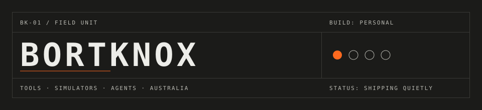

<p align="center">
  
</p>

```
UNIT      BORTKNOX
LOCATION  AUSTRALIA
FOCUS     SINGLE-FILE TOOLS / HARDWARE SIMULATORS / DESKTOP AGENTS
ASK ME    ESP32 CIRCUITS / BOARD DESIGN / RETROFITTING HARDWARE / PYTHON DIAGNOSTICS
POLICY    BUILT FOR MY OWN BENCH. SHARED OPEN. NO SUPPORT DESK.
```

I build tools for myself, then leave them out in the open. Most start as one file with no dependencies and
grow only when they have to. Some are for real hardware, some are for the desktop, all of them are
designed before they are coded.

## ON THE BENCH

| Project | What it is | Stack |
|---|---|---|
| **[COWON A2 / TE BENCH](https://github.com/BortKnox/Cowon-a2-transformation-demo)** | A rebuilt COWON iAUDIO A2 as a playable canvas, plus a Windows transcoder for the real device. | HTML, Canvas, Web Audio, Python |
| **[ULTRON](https://github.com/BortKnox/ultron)** | A desktop agent that sees the screen, speaks, and operates the computer, with a custom persona and a hand-built state orb. | Electron, Vue 3, TypeScript |
| **[DMM](https://github.com/BortKnox/DMM)** | A dark, fast TorBox front end with source search, a library and a Stremio plugin. | React, FastAPI, MongoDB |

## HOW I BUILD

- One file first. A dependency has to earn its place.
- Black screen, thin lines, uppercase telemetry. No shadows, no gradients, no gimmicks.
- Frozen versions stay frozen. Fixes go into the next one.
- If it cannot be ported to real hardware, it gets cut.

## NOTES

These are personal projects. They are public so anyone can read, fork or borrow them, not because I run
them as services. Issues and pull requests may sit unanswered, and forking is always the right move.

Side channel: I track deep specials at Coles like it is a second job.

[Instagram](https://instagram.com/Bort.knox) · [Support the bench](https://paypal.me/BortMack)
