




<a href="https://github.com/BortKnox/Cowon-a2-transformation-demo"></a>
<a href="https://github.com/BortKnox/ultron"></a>
<a href="https://github.com/BortKnox/DMM"></a>
<a href="https://bortknox.github.io/omniroute-field-station/"></a>
<a href="https://github.com/BortKnox?tab=repositories"></a>
<a href="https://github.com/BortKnox?tab=repositories"></a>




**Policy.** Everything here is built for my own bench first. It is public so anyone can read it, fork it or
borrow from it, not because I run it as a service. Issues and pull requests may sit unanswered. Forking is
always the right move.

**Ask me about** ESP32 circuits, board design, retrofitting hardware and automated Python diagnostics.

**Side channel.** I track deep specials at Coles like it is a second job.

[Instagram](https://instagram.com/Bort.knox) · [Support the bench](https://paypal.me/BortMack)


